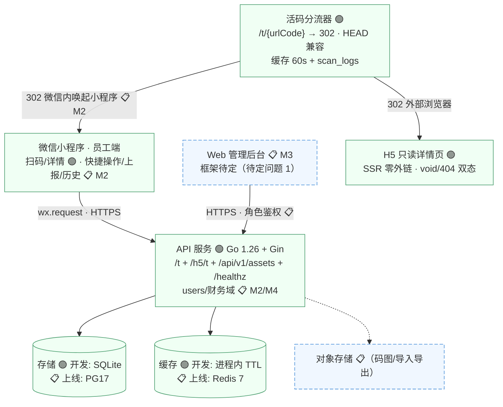

# MuTag（青沐动态码）· 企业资产活码管理小程序 — AI 上下文文档

> 代号：**MuTag** ｜ 版本：**V1.1（M1 落地实态）** ｜ 更新时间：2026-11-16
> 发布版本规程：**V1.0.x 第 3 位递增**（当前发布版 **V1.0.1**，锚定 e7954df M1-M4 全量）——`sh scripts/next_version.sh calc patch` 算号 / `apply patch` 一条命令全自动（三件套+commit+tag+push，脏工作区拒绝）；发布版（git tag/CHANGELOG.md）与本文档 changelog（AI 上下文文档演进线 V1.x）是两条线
> 维护：init-architect 首轮 + /zcf:workflow 增量 · 配套索引：[.claude/index.json](./.claude/index.json)
> 唯一事实来源：[MuTag-项目设计方案.md](./MuTag-项目设计方案.md)（v0.1，2026-11-16）——本文档全部内容提炼自它，冲突时以设计方案为准

---

## 变更记录 (Changelog)

| 日期 | 版本 | 变更内容 |
|------|------|----------|
| 2026-11-16 | V1.0 | 🆕 首轮初始化（规划态）：项目为**零代码纯设计稿阶段**，仅存在设计方案 v0.1 + `.spec-workflow/` 工具模板；生成根级 CLAUDE.md + 基座级 index.json；按设计方案提炼 4 个规划模块（目录均未创建，暂不生成模块级 CLAUDE.md）；画出规划架构 Mermaid 图；录入关键纪律 / M1-M4 里程碑 / 3 项待定问题 |
| 2026-11-16 | V1.1 | 🚀 **M1 落地（活码双链路）**：backend（Go 1.26+Gin+SQLite）+ miniprogram（原生，scan/detail 两页）+ deploy（验收脚本）建成；xlsx 真实数据 64 行→一物一码 74 条导入；**存储形态裁决：开发/验收 SQLite+内存缓存（零外部依赖），PG17+Redis7 保留为上线形态**；自研轻量迁移器替代 golang-migrate（离线缓存断供）；ui-ux-designer 设计+审查闭环（0 P0，P1×3/P2×16 已修）；README/deploy/README/verify.sh 同步实态 |
| 2026-11-16 | V1.2 | 🏢 **M3 提前落地（管理后台，财务留 M4）**：admin-web（React 19 + AntD 6 + Vite + TS）——登录/台账 CRUD/码管理/批量导入/统计四模块；**框架选型拍板 React+AntD（待定问题 1 关闭）**；xlsx 前端 SheetJS 解析（后端零新依赖）；构建产物 embed 进 Go 二进制（/admin SPA fallback）；鉴权 = env ADMIN_PASSWORD + HMAC token（空=免鉴权）；**进程内 e2e 全链集成测试**（14 项，绕沙箱端口限制）全绿；踩坑：Go fmt 不支持 %*d、gin FileFromFS 内部 FileServer 对 index.html 301 |
| 2026-11-16 | V1.3 | 📱 **M2 主体落地（小程序闭环，真机联调留余）**：users 表（0002 迁移）+ 员工端登录（**dev 模式：WECHAT_APPID 未配时 openid=mock(code)，配凭证即切真 code2session**）+ 快捷操作四动作（领用/归还/报修/位置变更，写 event 纪律）+ 我的上报 + 扫码历史（本地缓存 100 条）+ 302 分流 WEAPP_JUMP_URL 可配；管理后台补**码版面打印**（前端 qrcode 生成活码 URL 码图 + A4 打印，M3 出口物理闭环）；e2e 扩至员工链路（dev 登录→四动作→我的上报）全绿 |
| 2026-11-16 | V1.4 | 💰 **M4 落地（财务对接全链路）**：0003 迁移三表（fin_mappings / export_jobs / import_batches）；**内置四模板播种**（用友U8固定资产卡片/金蝶云星空/管家婆/通用台账，kind 幂等 + version 递增）；**映射层格式转换收敛**（金额两位小数/状态中文/日期格式全在模板 def）；导出 = 模板映射输出行 + 后端审计留痕（操作人+过滤条件，XLSX 仍由前端 SheetJS 生成——延续 M3 零新依赖裁决）；**导入两段式**（preview 落库 pending → SN 匹配差异比对（新增/更新/错误行标红）→ confirm 事务入库并回填明细 → rollback 事务反向恢复（新增删资产+码置 void，更新按 old 快照回写））；后台新增「财务对接」页三 Tab（财务导入/导出/模板配置）；e2e 财务链路五段全绿；AssetFilter 扩 dept/入账区间，List 支持全量不分页；GOCACHE 需指到可写目录（沙箱拒写 ~/Library/Caches） |
| 2026-11-16 | V1.5 | 🛡️ **纪律 4 落地（扫码限流）+ 文档收尾**：进程内 IP 令牌桶（`internal/cache/limiter.go`，容量/速率 env 可配 `RATE_LIMIT_BURST=30`/`RATE_LIMIT_PER_SEC=5`，≤0 关闭），挂活码 302 + H5 双入口同桶，429 兜底；管理端 API 不受限流影响；单测 + e2e 限流专项全绿（Redis 替换点：仅换 limiter.go 实现，Allow 语义不变）；verify.sh 增至 15 连检（财务模板播种 + 导出审计）；PG 形态确认阻塞点：模块缓存无 pgx/lib-pq，上线需在线环境 `go mod tidy`；`.claude/index.json` 同步 v1.4.0 实态（规划态字段全量刷新，gaps 重排为验收/上线/提交三线） |
| 2026-11-16 | V1.6 | 🚀 **发布 GitHub 公开仓**：`github.com/changzhi777/MuTag` 上线（用户裁决：公开 / xlsx 真实数据入库 / .claude 排除）；首次提交 `22e1ebb`（104 文件，M1-M4 全量），杂物预清（tsbuildinfo / backend/server 二进制 / .spec-workflow 模板入 .gitignore）；密钥预扫干净；沙箱内 gh 走 TLS MITM 不可用，建仓推送由用户终端执行（`gh repo create --public --source --push`）；远端 main = 本地 = 22e1ebb，工作区 clean |
| 2026-11-16 | V1.7 | 📊 **台账表格编辑（GitHub 选型深挖后落地）**：选型实测 GitHub API（stars/许可/维护）：Univer 27.5K Apache-2.0（xlsx 直读在收费 Pro 插件，排除）/ Handsontable 商用双许可（排除）/ fortune-sheet、x-spreadsheet 弃养（排除）→ 定 **react-data-grid 7.0.0-beta.64（Comcast，MIT，★7.7K）** + 已有 SheetJS；新「表格编辑」页：台账全量网格行内编辑（改动列高亮、资产码只读——纪律 1）→ 改动集走 `fin/import/preview` 新增 **_tag_id 直匹配通道**（不走模板反查，网格场景字段名直用系统名，含 price/date/值域校验）→ 人工确认入库（审计/回滚链路全复用）；**顺手修 diffUpdate 真 bug**：库内空值→有值的变化被跳过比较（FinanceChain 测试盲区，GridEdit 测试揭出）；bundle +72KB；e2e TestE2EGridEdit 全绿。同期并入：PG 上线形态准备（repo 方言清零——14 INSERT 显式时间戳 + 6 处 strftime 参数化、db 双形态 OpenSQLite/OpenPostgres + Migrate 方言版本线、0001-0003 PG 迁移、main.go DATABASE_URL 分支；pgx driver 注册待在线环境 go get 后解除 main.go 注释）+ 版本规程（V1.0.x） |
| 2026-11-16 | V1.8 | ☁️ **上线形态裁决 Supabase + pgx 激活**：用户裁定 **Supabase 托管 PG17 替代自建 PG17**（本质 = 托管 Postgres，引擎零改动，切换 = 换 DSN）；`go get pgx v5.13.0`（用户环境拉取，首试 zip 断传 go get 原子回滚，重试成功）；main/cmd/migrate driver 注册激活，SQLite 全量零回归；e2e 增 **MUTAG_TEST_PG_DSN 双形态实证开关**（有值清 schema 重迁移跑全套）；新增 **cmd/migrate 独立迁移执行器**（部署期先迁移再起服务）；deploy/README 三档双轨重写（SQLite 开发 / Supabase 推荐 / 自建 PG17 备选，DSN 模板 + sslmode + pooler 要点）；本机 brew PG17 已装，沙箱 shm 拦截致 initdb 不可行，本地实证让位 Supabase 直连 |
| 2026-11-17 | V1.9 | ✅ **Supabase 真 PG 全套 e2e 实证 + 发版 V1.0.3**：Playwright 浏览器自主操作 Dashboard（用户 GitHub OAuth 登录后接管）确认项目 Healthy / region **ap-southeast-2 Sydney**（此前 TLS EOF 根因 = 连错 region pooler，Supavisor 按 ref 路由错 region 即断）；三修落地：① 占位符 **rebind 驱动包装**（pgx 全链路只认 $n 含 simple protocol sanitize——`internal/db/rebind_driver` 引号保护+动态 $n，repo 双方言一份 SQL 保持）② **simple protocol 强制**（transaction pooler 6543 下 prepared statement 残留 42P05 免疫）③ **RETURNING asset_id** 替代 LastInsertId（PG 不支持；SQLite 3.35+ 同支持）+ users INSERT 补显式 created_at（漏网 DEFAULT now()::text 格式炸）；终态：**迁移双跑幂等 + 全套 e2e（8 组含财务/网格/限流）在 Supabase PG17 全绿（63s）**，SQLite 回归零影响；deploy/README 标注实证；发版 V1.0.3（规程第三次实弹） |
| 2026-11-17 | V1.10 | 🚀 **腾讯云生产上线（43.129.201.118 · Lighthouse 香港）**：**https://mutag.qingmulife.com** 正式服务（TLS certbot 自动签发续期 / 活码域名语义完整 / 微信内可扫）；拓扑 = nginx(443 反代, 复用机上 nginx 占 80/443 故弃 Caddy) → mutag:18000(systemd) → Supabase pooler；部署全程 **OrcaTerm 网页终端自主执行**（SSH 22 被本机 Clash TUN 掐断，OrcaTerm 为运维通道）；附带 **满盘救援**（根分区 100% 满：/var/lib/docker 40G 孤儿镜像 90% → image prune 回收 30.15GB 至 53%，同机沐禾健身 PG/qingmulife 站写盘隐患一并解除；误发 docker prune -af 被 Ctrl+C 截停零损失）；IaC 归档 `deploy/tencent/`（mutag.service + nginx conf + 部署实录/排障记录，统一目录裁决 /opt/mutag/{src,mutag,env}）；DNS mutag.qingmulife.com A 记录（DNSPod 自主添加）；生产空库——真实资产待管理后台导入（衔接 M4 验收） |
| 2026-11-17 | V1.11 | 🔳 **QR 功能完善（对标草料·B 档全量）+ 生产首次更新实战**：调研（GitHub 7 库 API 实测 + 草料 cli.im 产品拆解）→ 选型 qr-code-styling 1.9.2（MIT ★3K）+ jszip；**码版面打印工场重构**（130 行 → 全量）：标签模板 4 规格（30×30/40×30/50×50/60×40 自动行列+切刀线）+ 字段勾选 + 码美化全量 UI（点阵 5 形状/单色渐变/角块/容错 L-TH/logo 嵌入/透明背景，localStorage 持久化）+ 台账多选批量（A4 页数自动 + PNG zip 导出）+ 扫码统计（后端 /tags/scan-stats 聚合 + e2e + 码管理列）；**生产首次更新实战**暴露 pooler 3F000（search_path 空 crash 循环 counter 35+）→ **应用/备份全部切直连**（db.<ref>:5432，绕开 pooler 全类问题；simple protocol 保留作保险）→ 生产全通（healthz/H5/scan-stats 鉴权拦截）；登录"失效"排障归档（密码生成链路不可见字符 → 三板斧：cat env / proc environ / 本机 curl）；发版 V1.0.4 |
| 2026-11-17 | V1.12 | 🔗 **活码域名收敛服务端配置（.cn 双轨）**：生成的 QR 链接原随后台入口域名漂移（.com/.cn 不定）→ 新增 `/api/admin/config` 下发 `BASE_URL`（单一事实源），打印工场活码内容改用服务端域名（fallback origin）；生产 BASE_URL 切 **https://mutag.qingmulife.cn**（.cn 入口，微信侧绕 .com 拦截）；`mutag.qingmulife.cn` A 记录 + nginx 301（路径透传）+ certbot TLS 全部上线并实测；运维通道经验：OrcaTerm 编辑器发送对双引号做 `\"` 转义破坏 bash 语法（单引号/零引号命令可行） |
---

## ⚠️ 项目现状声明（先读这段）

- **生产已上线（2026-11-17）**：**https://mutag.qingmulife.com**（腾讯云 Lighthouse 香港 43.129.201.118 · systemd + nginx TLS + Supabase PG17）；管理后台密码见远端 `/opt/mutag/mutag.env`；部署拓扑与排障实录见 `deploy/tencent/README.md`（IaC 归档）；生产空库——真实资产经管理后台导入（衔接 M4 验收）；Supabase 库中 000001-000003 为 e2e 残留测试数据
- **M1 已落地（2026-11-16）**：`backend/`（活码服务）+ `miniprogram/`（员工端两页）+ `deploy/`（验收）+ `README.md` 均已存在并可运行；出口标准「外部扫码看到资产页」已通过 `bash deploy/verify.sh` 七连检验证。
- **存储形态（关键裁决）**：开发/验收 = **SQLite**（modernc 纯 Go 驱动，`backend/data/mutag.db`，零外部依赖）+ 进程内 TTL 缓存；上线 = PG17+Redis7（`deploy/docker-compose.yml` 保留，切换点收敛在 `internal/db` 连接层 + 迁移方言文件）。**设计方案里的 Redis 限流/CDN 为 M2+ 上线项，M1 未实现。**
- **仓库实态**：GitHub 公开仓 `github.com/changzhi777/MuTag`（2026-11-16 首发 a/22e1ebb，M1-M4 单提交 104 文件）；`.gitignore` 含 .claude/.zcf/.spec-workflow/.pnpm-store/backend/server/*.tsbuildinfo；真实数据 xlsx 按用户裁决入库
- `.spec-workflow/` 是 spec-workflow MCP 工具的模板目录，**不是项目模块**，勿当作代码阅读。

---

## 项目愿景

**每个资产贴一个"码不变、内容随时改"的活码**：员工微信扫码即看资产全生命周期，管理员后台改信息即时生效，财务导出直接对上用友/金蝶模板。

命名释义：Mu（青沐）+ Tag（资产标签）——码是死的，Tag 是活的。与沐禾健身（Muhe Fit）构成青沐系产品命名族。

### 活码核心机制（一物双码，码不变内容改）

| 码 | 形态 | 场景 |
|---|---|---|
| 小程序码 | 微信 `getUnlimitedQRCode`，scene=`t:{tagId}`，永久码 | 微信内扫码直达小程序资产页（首选路径） |
| 活码 URL | 普通二维码，内容 `https://mu.qingmu.cn/t/{tagId}` | 外部扫码枪/相机/非微信环境；微信内扫码 302 → 唤起小程序 |

内容更新 = 改 `tags` 表绑定的资产数据，扫码即最新——**码图物理上永不需要重印**。每次变更存 `asset_events` 履历快照，扫码详情页可看完整时间线。防伪扩展位：活码 URL 支持 `?sig=HMAC(tagId+ts)` 滚动签名（二期）。

---

## 架构总览（实态 + 规划混合）

> 🟢 = M1 已实现；📋 = 待建（M2+）。

**业务链路**：贴码（后台批量生成 + 打印 PDF 版面）→ 员工微信/外部扫码 → API（缓存命中则 <200ms 返回）→ 详情/快捷操作（写 `asset_events` 履历）→ 管理后台台账与财务模板配置 → 异步导出 XLSX 对齐用友 U8 / 金蝶云星空 / 管家婆模板（或反向导入，差异预览后入库）。

---

## 模块索引

> M1 已落地模块见 CLAUDE.md 详档（增量运行 `/zcf:init-project` 自动生成）。

| 路径 | 职责 | 状态 | 技术栈 | 备注 |
|---|---|---|---|---|
| `backend/` | 活码服务：/t 分流 + /h5 SSR + /api/v1 JSON + healthz；四表自迁移；seed 两步导入 | 🟢 M1 已建 | Go 1.26 + Gin + SQLite（modernc） | `internal/{domain,repo,api,h5,db,cache,config}`；测试：api 分流 + h5 渲染 smoke |
| `miniprogram/` | 员工端：扫码首页 + 详情 + 快捷操作四动作 + 我的上报 + 扫码历史 | 🟢 M2 主体已建 | 原生微信小程序（测试号） | 登录 dev 模式（WECHAT_APPID 未配=mock openid）；真机联调 📋 |
| `admin-web/` | 管理后台：登录/台账 CRUD/码管理/批量导入/**财务对接（模板配置+导出审计+导入预览确认回滚）**/统计（财务模板 📋 M4；PDF 打印版面 📋） | 🟢 M3 提前已建 | React 19 + AntD 6 + Vite + TS | 构建产物 embed 进 Go 二进制；`bash admin-web/build.sh` 一键重建 |
| `deploy/` | verify.sh 一键验收 + PG 上线 compose + README（形态说明） | 🟢 M1 已建 | bash / docker-compose | 验收 15 连检（含 M4 财务）；PG 形态 M2+ 切换 |

**关键文件**：[README.md](./README.md)（快速开始）· [deploy/README.md](./deploy/README.md)（存储形态切换点）· [deploy/verify.sh](./deploy/verify.sh)（验收脚本）· `backend/internal/h5/templates/`（UI 设计 token 全表）

---

## 数据模型速览（核心表，详见设计方案第 4 节）

| 表 | 职责 | 关键点 |
|---|---|---|
| `tags` | 码表 | tag_id(PK), qr_scene, url_code, status(active/void)；**tagId 永不 recycle** |
| `assets` | 资产 | tag_id(FK), name/category/model/sn/price/dept/keeper/location, status(在用/闲置/维修/借出/报废) |
| `asset_events` | 履历快照 | 领用/归还/维修/调拨/报废/信息变更，actor + old_value→new_value(JSON) |
| `scan_logs` | 扫码日志 | tag_id, actor, channel(weapp/h5/gun), ip |
| `users` | 用户 | 微信 openid/unionid + 角色(admin/asset_mgr/staff) |
| `fin_mappings` | 财务模板 | 用友U8/金蝶星空/管家婆，column_map(JSON) + fixed_rows + version |
| `export_jobs` | 导出任务 | 资产过滤条件 + mapping_id + 文件 URL + 状态（异步） |
| `import_batches` | 导入批次 | 文件 URL + 解析结果 + 错误行报告(JSON) + 确认状态，**支持按批次回滚** |

---

## 全局规范（关键纪律，代码落地后强制执行）

1. **tagId 永不 recycle**（与沐禾 catalogue id 同纪律）：资产报废后码作废归档（status=void），码号不复用。
2. **版本快照强制**：资产字段级变更全量写 `asset_events`（谁/何时/改了什么字段/旧值→新值），无旁路。
3. **扫码性能红线 <200ms P95**：tagId→资产详情 Redis 缓存 TTL 60s，变更即失效；活码 302 走 CDN。
4. **扫码限流**：按 openid 令牌桶防爬。
5. **财务导出审计留痕**：记录操作人与过滤条件（财务合规）；导入必须"预览差异 → 人工确认 → 入库 → import_batch 留档"，支持按批次回滚。
6. **一物双码**：小程序码（scene=`t:{tagId}`）+ 活码 URL 二维码并存；内容更新只改数据，码图永不重印。
7. **格式转换收敛在映射层**：金额/日期/部门编码系统内统一存储，用友/金蝶各自的日期格式与部门编码对照由 `fin_mappings` 负责（对照表可上传）。
8. **权限模型**：admin（全部+模板配置+用户管理）/ asset_mgr（资产 CRUD、码管理、导入导出、审批上报）/ staff（默认，扫码查看 + 领用报修上报 + 本人记录）；鉴权统一在 API 中间件。
9. **staff 对资产只读**，只能发起 event（领用/报修等）。
10. **快捷操作表单 ≤3 字段**：提交即写 event，员工端从简。
11. **部署**：家庭实验室 PVE CT（deploy-ct151 模式），HTTPS；备份 = PG dump + 文件目录。

---

## 里程碑（每阶段 2 周）

| 阶段 | 内容 | 出口标准 |
|---|---|---|
| **M1** ✅ | 后端骨架 + 资产/码表 + 活码 302 + H5 只读详情（+ 小程序扫码/详情两页提前交付 + xlsx 真实数据 74 条） | 外部扫码看到资产页 —— **已达成**（verify.sh 七连检） |
| **M3 提前** 🔶 | 管理后台四模块（台账 CRUD / 码管理 / 批量导入 / 统计）—— 财务模板留 M4、码批量生成打印 PDF 版面 📋 未做 | 盘点可用 —— **核心达成**（进程内 e2e 14 项全绿；浏览器走查待人工） |
| **M2 主体** 🔶 | 员工端登录（dev 模式）+ 快捷操作四动作 + 我的上报 + 扫码历史 + 302 分流可配 —— PG/Redis 切换与真机联调 📋 | 员工全流程微信内闭环 —— **逻辑链路达成**（e2e 员工链路全绿），真机待验 |
| **M4** 🔶 | 财务模板 + 导入导出任务 + 差异预览/回滚 —— 逻辑链路已落地（e2e 五段全绿）；**用真实用友/金蝶文件各跑通一份** 📋 待人工验收 | 用友/金蝶模板各跑通一份真实数据 —— **代码达成，真实数据验收待做** |

---

## 待定问题清单（设计方案第 10 节，下一轮确认）

1. **管理后台框架最终选型**：Vue3+Element Plus vs React+AntD——二选一后钉死（沐禾 frontend 为 React，复用经验有优势）。
2. **是否需要离线盘点模式**：无网仓库批量扫码，回网同步。
3. **资产是否需对接现有 OA/钉钉**：领用审批流。

---

## AI 使用指引

1. **一切以设计方案为准**：动手前先读 [MuTag-项目设计方案.md](./MuTag-项目设计方案.md)；本文档是其 AI 上下文提炼，两者冲突时以设计方案为准。
2. **M1 代码已存在**：`backend/`、`miniprogram/`、`deploy/`、`admin-web/` 均为实态，改代码前先读对应模块
3. **构建环境特殊性**：本机沙箱代理拦截 Go proxy，离线构建用 `GOFLAGS="-mod=mod -buildvcs=false" GOPROXY=off GOSUMDB=off`（依赖走模块缓存）；在线环境正常 `go mod tidy`。本地端口绑定被沙箱禁，起服务/验收用 `!` 前缀在会话外跑（verify.sh）。
4. **存储双形态**：改 SQL/存储层时注意 SQLite（开发）与 PG（上线）方言双轨，迁移文件按方言各自维护于 `internal/db/migrations/`。
5. **仓库已发布 GitHub**：`github.com/changzhi777/MuTag`（公开）；日常开发 commit + push 到 main；沙箱内 gh/git 走 TLS MITM 不可用，远端操作用 `!` 前缀在会话外跑
6. `.spec-workflow/` 为 spec-workflow MCP 工具模板，仅用于规格流程，不是项目代码。

---

## 相关文件

- [MuTag-项目设计方案.md](./MuTag-项目设计方案.md) — 唯一事实来源（v0.1，2026-11-16）
- [README.md](./README.md) — 快速开始与开发约束
- [deploy/verify.sh](./deploy/verify.sh) — 一键验收（七连检）
- [.claude/index.json](./.claude/index.json) — 基座级扫描索引（v1.0.0，规划态；待随 V1.1 增量）
