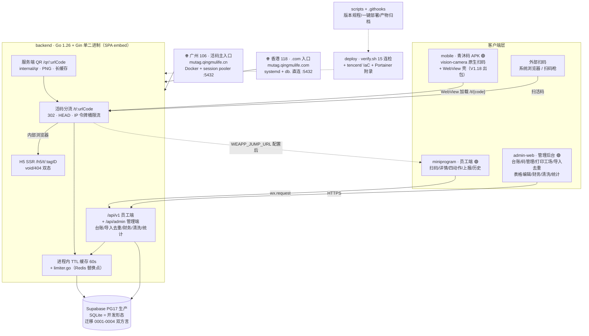

# MuTag（青沐动态码）· 企业资产活码管理小程序 — AI 上下文文档

> 代号：**MuTag** ｜ 版本：**V1.18（青沐码 Android APK 落地轮）** ｜ 更新时间：2026-11-23 23:06 (CST)
> 发布版本规程：**V1.0.x 第 3 位递增**（当前发布版 **V1.0.4**）——`sh scripts/next_version.sh calc patch` 算号 / `apply patch` 一条命令全自动（三件套+commit+tag+push，脏工作区拒绝）；发布版（git tag/CHANGELOG.md）与本文档 changelog（AI 上下文文档演进线 V1.x）是两条线
> 维护：init-architect 首轮 + /zcf:workflow 增量 · 配套索引：[.claude/index.json](./.claude/index.json)
> 唯一事实来源：[MuTag-项目设计方案.md](./MuTag-项目设计方案.md)（v0.1，2026-11-16）——本文档全部内容提炼自它，冲突时以设计方案为准

---

## 变更记录 (Changelog)

| 日期 | 版本 | 变更内容 |
|------|------|----------|
| 2026-11-16 | V1.0 | 🆕 首轮初始化（规划态）：项目为**零代码纯设计稿阶段**，仅存在设计方案 v0.1 + `.spec-workflow/` 工具模板；生成根级 CLAUDE.md + 基座级 index.json；按设计方案提炼 4 个规划模块（目录均未创建，暂不生成模块级 CLAUDE.md）；画出规划架构 Mermaid 图；录入关键纪律 / M1-M4 里程碑 / 3 项待定问题 |
| 2026-11-16 | V1.1 | 🚀 **M1 落地（活码双链路）**：backend（Go 1.26+Gin+SQLite）+ miniprogram（原生，scan/detail 两页）+ deploy（验收脚本）建成；xlsx 真实数据 64 行→一物一码 74 条导入；**存储形态裁决：开发/验收 SQLite+内存缓存（零外部依赖），PG17+Redis7 保留为上线形态**；自研轻量迁移器替代 golang-migrate（离线缓存断供）；ui-ux-designer 设计+审查闭环（0 P0，P1×3/P2×16 已修）；README/deploy/README/verify.sh 同步实态 |
| 2026-11-16 | V1.2 | 🏢 **M3 提前落地（管理后台，财务留 M4）**：admin-web（React 19 + AntD 6 + Vite + TS）——登录/台账 CRUD/码管理/批量导入/统计四模块；**框架选型拍板 React+AntD（待定问题 1 关闭）**；xlsx 前端 SheetJS 解析（后端零新依赖）；构建产物 embed 进 Go 二进制（/admin SPA fallback）；鉴权 = env ADMIN_PASSWORD + HMAC token（空=免鉴权）；**进程内 e2e 全链集成测试**（14 项，绕沙箱端口限制）全绿；踩坑：Go fmt 不支持 %*d、gin FileFromFS 内部 FileServer 对 index.html 301 |
| 2026-11-16 | V1.3 | 📱 **M2 主体落地（小程序闭环，真机联调留余）**：users 表（0002 迁移）+ 员工端登录（**dev 模式：WECHAT_APPID 未配时 openid=mock(code)，配凭证即切真 code2session**）+ 快捷操作四动作（领用/归还/报修/位置变更，写 event 纪律）+ 我的上报 + 扫码历史（本地缓存 100 条）+ 302 分流 WEAPP_JUMP_URL 可配；管理后台补**码版面打印**（前端 qrcode 生成活码 URL 码图 + A4 打印，M3 出口物理闭环）；e2e 扩至员工链路（dev 登录→四动作→我的上报）全绿 |
| 2026-11-16 | V1.4 | 💰 **M4 落地（财务对接全链路）**：0003 迁移三表（fin_mappings / export_jobs / import_batches）；**内置四模板播种**（用友U8固定资产卡片/金蝶云星空/管家婆/通用台账，kind 幂等 + version 递增）；**映射层格式转换收敛**（金额两位小数/状态中文/日期格式全在模板 def）；导出 = 模板映射输出行 + 后端审计留痕（操作人+过滤条件，XLSX 仍由前端 SheetJS 生成——延续 M3 零新依赖裁决）；**导入两段式**（preview 落库 pending → SN 匹配差异比对（新增/更新/错误行标红）→ confirm 事务入库并回填明细 → rollback 事务反向恢复（新增删资产+码置 void，更新按 old 快照回写））；后台新增「财务对接」页三 Tab（财务导入/导出/模板配置）；e2e 财务链路五段全绿；AssetFilter 扩 dept/入账区间，List 支持全量不分页；GOCACHE 需指到可写目录（沙箱拒写 ~/Library/Caches） |
| 2026-11-16 | V1.5 | 🛡️ **纪律 4 落地（扫码限流）+ 文档收尾**：进程内 IP 令牌桶（`internal/cache/limiter.go`，容量/速率 env 可配 `RATE_LIMIT_BURST=30`/`RATE_LIMIT_PER_SEC=5`，≤0 关闭），挂活码 302 + H5 双入口同桶，429 兜底；管理端 API 不受限流影响；单测 + e2e 限流专项全绿（Redis 替换点：仅换 limiter.go 实现，Allow 语义不变）；verify.sh 增至 15 连检（财务模板播种 + 导出审计）；PG 形态确认阻塞点：模块缓存无 pgx/lib-pq，上线需在线环境 `go mod tidy`；`.claude/index.json` 同步 v1.4.0 实态（规划态字段全量刷新，gaps 重排为验收/上线/提交三线） |
| 2026-11-16 | V1.6 | 🚀 **发布 GitHub 公开仓**：`github.com/changzhi777/MuTag` 上线（用户裁决：公开 / xlsx 真实数据入库 / .claude 排除）；首次提交 `22e1ebb`（104 文件，M1-M4 全量），杂物预清（tsbuildinfo / backend/server 二进制 / .spec-workflow 模板入 .gitignore）；密钥预扫干净；沙箱内 gh 走 TLS MITM 不可用，建仓推送由用户终端执行（`gh repo create --public --source --push`）；远端 main = 本地 = 22e1ebb，工作区 clean |
| 2026-11-16 | V1.7 | 📊 **台账表格编辑（GitHub 选型深挖后落地）**：选型实测 GitHub API（stars/许可/维护）：Univer 27.5K Apache-2.0（xlsx 直读在收费 Pro 插件，排除）/ Handsontable 商用双许可（排除）/ fortune-sheet、x-spreadsheet 弃养（排除）→ 定 **react-data-grid 7.0.0-beta.64（Comcast，MIT，★7.7K）** + 已有 SheetJS；新「表格编辑」页：台账全量网格行内编辑（改动列高亮、资产码只读——纪律 1）→ 改动集走 `fin/import/preview` 新增 **_tag_id 直匹配通道**（不走模板反查，网格场景字段名直用系统名，含 price/date/值域校验）→ 人工确认入库（审计/回滚链路全复用）；**顺手修 diffUpdate 真 bug**：库内空值→有值的变化被跳过比较（FinanceChain 测试盲区，GridEdit 测试揭出）；bundle +72KB；e2e TestE2EGridEdit 全绿。同期并入：PG 上线形态准备（repo 方言清零——14 INSERT 显式时间戳 + 6 处 strftime 参数化、db 双形态 OpenSQLite/OpenPostgres + Migrate 方言版本线、0001-0003 PG 迁移、main.go DATABASE_URL 分支；pgx driver 注册待在线环境 go get 后解除 main.go 注释）+ 版本规程（V1.0.x） |
| 2026-11-16 | V1.8 | ☁️ **上线形态裁决 Supabase + pgx 激活**：用户裁定 **Supabase 托管 PG17 替代自建 PG17**（本质 = 托管 Postgres，引擎零改动，切换 = 换 DSN）；`go get pgx v5.13.0`（用户环境拉取，首试 zip 断传 go get 原子回滚，重试成功）；main/cmd/migrate driver 注册激活，SQLite 全量零回归；e2e 增 **MUTAG_TEST_PG_DSN 双形态实证开关**（有值清 schema 重迁移跑全套）；新增 **cmd/migrate 独立迁移执行器**（部署期先迁移再起服务）；deploy/README 三档双轨重写（SQLite 开发 / Supabase 推荐 / 自建 PG17 备选，DSN 模板 + sslmode + pooler 要点）；本机 brew PG17 已装，沙箱 shm 拦截致 initdb 不可行，本地实证让位 Supabase 直连 |
| 2026-11-17 | V1.9 | ✅ **Supabase 真 PG 全套 e2e 实证 + 发版 V1.0.3**：Playwright 浏览器自主操作 Dashboard（用户 GitHub OAuth 登录后接管）确认项目 Healthy / region **ap-southeast-2 Sydney**（此前 TLS EOF 根因 = 连错 region pooler，Supavisor 按 ref 路由错 region 即断）；三修落地：① 占位符 **rebind 驱动包装**（pgx 全链路只认 $n 含 simple protocol sanitize——`internal/db/rebind_driver` 引号保护+动态 $n，repo 双方言一份 SQL 保持）② **simple protocol 强制**（transaction pooler 6543 下 prepared statement 残留 42P05 免疫）③ **RETURNING asset_id** 替代 LastInsertId（PG 不支持；SQLite 3.35+ 同支持）+ users INSERT 补显式 created_at（漏网 DEFAULT now()::text 格式炸）；终态：**迁移双跑幂等 + 全套 e2e（8 组含财务/网格/限流）在 Supabase PG17 全绿（63s）**，SQLite 回归零影响；deploy/README 标注实证；发版 V1.0.3（规程第三次实弹） |
| 2026-11-17 | V1.10 | 🚀 **腾讯云生产上线（43.129.201.118 · Lighthouse 香港）**：**https://mutag.qingmulife.com** 正式服务（TLS certbot 自动签发续期 / 活码域名语义完整 / 微信内可扫）；拓扑 = nginx(443 反代, 复用机上 nginx 占 80/443 故弃 Caddy) → mutag:18000(systemd) → Supabase pooler；部署全程 **OrcaTerm 网页终端自主执行**（SSH 22 被本机 Clash TUN 掐断，OrcaTerm 为运维通道）；附带 **满盘救援**（根分区 100% 满：/var/lib/docker 40G 孤儿镜像 90% → image prune 回收 30.15GB 至 53%，同机沐禾健身 PG/qingmulife 站写盘隐患一并解除；误发 docker prune -af 被 Ctrl+C 截停零损失）；IaC 归档 `deploy/tencent/`（mutag.service + nginx conf + 部署实录/排障记录，统一目录裁决 /opt/mutag/{src,mutag,env}）；DNS mutag.qingmulife.com A 记录（DNSPod 自主添加）；生产空库——真实资产待管理后台导入（衔接 M4 验收） |
| 2026-11-17 | V1.11 | 🔳 **QR 功能完善（对标草料·B 档全量）+ 生产首次更新实战**：调研（GitHub 7 库 API 实测 + 草料 cli.im 产品拆解）→ 选型 qr-code-styling 1.9.2（MIT ★3K）+ jszip；**码版面打印工场重构**（130 行 → 全量）：标签模板 4 规格（30×30/40×30/50×50/60×40 自动行列+切刀线）+ 字段勾选 + 码美化全量 UI（点阵 5 形状/单色渐变/角块/容错 L-TH/logo 嵌入/透明背景，localStorage 持久化）+ 台账多选批量（A4 页数自动 + PNG zip 导出）+ 扫码统计（后端 /tags/scan-stats 聚合 + e2e + 码管理列）；**生产首次更新实战**暴露 pooler 3F000（search_path 空 crash 循环 counter 35+）→ **应用/备份全部切直连**（db.<ref>:5432，绕开 pooler 全类问题；simple protocol 保留作保险）→ 生产全通（healthz/H5/scan-stats 鉴权拦截）；登录"失效"排障归档（密码生成链路不可见字符 → 三板斧：cat env / proc environ / 本机 curl）；发版 V1.0.4 |
| 2026-11-17 | V1.12 | 🔗 **活码域名收敛服务端配置（.cn 双轨）**：生成的 QR 链接原随后台入口域名漂移（.com/.cn 不定）→ 新增 `/api/admin/config` 下发 `BASE_URL`（单一事实源），打印工场活码内容改用服务端域名（fallback origin）；生产 BASE_URL 切 **https://mutag.qingmulife.cn**（.cn 入口，微信侧绕 .com 拦截）；`mutag.qingmulife.cn` A 记录 + nginx 301（路径透传）+ certbot TLS 全部上线并实测；运维通道经验：OrcaTerm 编辑器发送对双引号做 `\"` 转义破坏 bash 语法（单引号/零引号命令可行） |
| 2026-11-17 | V1.13 | 🧪 **生产真机测试轮 + 入口定案（方案 A 独立运行）**：登录修复（ADMIN_PASSWORD 重设 → 旧会话失效为预期安全行为）+ 单枚标签 hover 下载 PNG/SVG 上线；真机扫码排障定案——微信拦截 `qingmulife.com/cn`（均未备案，香港机无法备案），用户裁定 **方案 A：MuTag 独立运行**（不走备案/境内机路线）；双域名入口定案（.com 主 + .cn 直连，互不跳转）+ QR 内容 = mutag.qingmulife.cn（BASE_URL 收敛生效）；可立即用路径：**手机系统浏览器扫活码**（绕微信 ✓）+ 小程序「手动输入编号」MT-2026-000004（体验版真机受域名校验限制已知）；扫码计数已在生产工作（000004=5 次 / 000001=2 次，e2e+实测数据入 scan_logs）；IaC 同步（mutag-cn.nginx.conf server_name 修正 qingmulife.cn） |
| 2026-11-17 | V1.14 | 🚀 **生产入口迁移广州 106（活码主入口）+ 服务端 QR 端点 + Portainer**：**DNSPod 权威把 mutag.qingmulife.cn 切至广州 106（106.53.168.73）**——踩坑：单条「添加记录」UI 不推权威（等 10 分钟 NXDOMAIN），**批量操作通道（txt 导入/批量修改）秒推**；106 连接形态 = **session pooler :5432 + simple protocol**（106 无 IPv6 出口连不上 db. 直连 IPv6，与 118 直连形态并存不强求统一）；certbot 一条命令签 .cn TLS；**服务端活码 QR 端点 `/qr/:urlCode?size=` 上线**（skip2/go-qrcode 薄封装，公开+限流同桶+Cache-Control 86400，e2e 七断言；部署坑：skip2 无 tag 须从 goproxy @latest 取 pseudo-version 真值、alpine 缺 git 用 docker.1ms.run/golang:1.26 跑 tidy）；**Portainer 汉化版**上 106（ser.qingmulife.cn/docker，--admin-password-file 通道，nginx 尾斜杠剥前缀）；**go.sum 欠账清偿**（skip2 双哈希入库）：本机沙箱 TLS MITM 拦 Go proxy → curl 拉 zip/mod + `GOPROXY=file://` 离线算官方哈希 + sum.golang.org 权威记录逐字比对锚定，GOMODCACHE/GOCACHE 指 APFS 克隆目录，全量 build + test 全绿；IaC 归档 mutag-gz106.nginx.conf |
| 2026-11-17 | V1.15 | 🛡️ **重复事故根治三连（P0/P1/P2）+ 66 条清理实战 + LAN 数据库盘点**：**事故**：antd 6 × React 19 静态 message 全静默 → 导入三连点 66 条重复入库（135→74 收敛）。**P0 提示根治**：main.tsx 四层包裹 AntdApp + 12 文件 43 处静态 message 换 App.useApp() + build.sh 防回归闸门（/usr/bin/grep 绝对路径兼容 ugrep + 双形态检测 + \|\| true 防 set -e 误杀，拦截/通过双测）。**P1 导入去重**：utils/date.ts 序列号 UTC 数学（cellDates 本地时区补偿实测 04-23 读成 04-22，序列号 46135=04-23 权威）+ internal/api/dedupe.go 键归一化 min/max 幂等（name\|keeper\|date 小写压空白）+ /import/precheck 只读预检 + /import dedup 默认 true（force 逃生口）+ ImportPage 预检三态 UI（新建/跳过/疑似 Popover）+ e2e 六场景全绿；**生产验收彩蛋**：precheck 算出「将新建 5 条」正好补齐首次点击中断的缺失资产，台账 73→78 对账闭环。**66 条重复清理**：curl/Playwright 双通道精确比对（name\|keeper 聚合避时区漂移）→ Supabase SQL Editor 事务删（4 表快照 _bak_1117_* 可回滚）→ 139→73 全绿。**P2 存量清洗功能**：0004 迁移双方言 cleanup_jobs 审计 + cleanup_repo（快照 4 表/单事务原子清理/restore 回补/PG setval 序列重推）+ cleanup API（scan 预标 delete/void 双 action——无履历无扫码才删、有履历改报废保留 + execute confirm_count 防误触 + jobs 审计列表）+ CleanupPage 三步流 UI（Steps/Segmented 策略/行级色标/danger confirm/Result 快照恢复）；**纪律 1 推论落地**：tags 永不物理删（nextTagID=MAX+1 实证物理删必致码号回池）一律置 void 保留号簿；e2e TestE2ECleanupChain 全绿（分组预标/混合清理/confirm 拒绝/快照回滚/tags 恢复/号不复用）；修五坑：SQLite 方言 now()::text、modernc 多 VALUES 占位符、快照表名连字符非法、events/scanlogs 快照命名不一致、MarkExecuted 参数序错位（executed_at 收 jobID）；**验收实战再揪 keepN=1 误判**——8 组「重复」实为 xlsx qty 语义合法多件（险误删 11 条），单簇保护上线（同簇数=1 且无权威文件 → 整组不进重复列表，生产复扫 78 条 0 重复绿条实证）。**LAN 数据库盘点**：10.10.10.0/24 扫描（nc 初扫 + nmap -sT 复核，nc 有假阳性 .150/.12:6379）→ 2 PG（.11/.12，pg_hba 未放行本机段）+ 4 Redis（.11 裸奔 ⚠️ / .13/.14/.18 有密码）；DB Kit 连接配置总表 `.zcf/plan/current/db-kit-connections.md`（14 条：Supabase×2/LAN×5/云隧道×3/SQLite×4）；**运维通道新增**：Playwright MCP 有腾讯云登录态可全程自主操作 OrcaTerm（免密 TAT/root，SSH 22 被 Clash TUN 掐断的替代通道） |
| 2026-11-18 | V1.16 | 📚 **模块详档首建 ×4 + 产物归档工具链 + 服务端 QR 实态入档**：① **四模块 CLAUDE.md 首次生成**（[backend](./backend/CLAUDE.md) / [admin-web](./admin-web/CLAUDE.md) / [miniprogram](./miniprogram/CLAUDE.md) / [deploy](./deploy/CLAUDE.md)，均带导航面包屑——首轮规划态未建，本轮补齐；接口全景 / 双形态存储 / 21 测试函数 / 打印工场与 message 闸门 / 双活拓扑与 Portainer 附录逐一入档）② **产物自动归档工具链**：`scripts/tidy_artifacts.sh`（根目录散落 png→`deploy/tencent/screenshots/`、yml→`.playwright-mcp/snapshots/`；护栏=git 已跟踪文件一律不动、同名追加后缀永不覆盖）+ `.githooks/pre-commit`（core.hooksPath 已挂——提交即自动整理）③ **服务端 QR 端点实态确认入档**（上线本身见 V1.14）：`internal/qr`（skip2 薄封装，size 钳 64-1024 缺省 512）+ `internal/api/qr.go`（复用 lookupTagID 校验，void→404 与分流语义一致）+ e2e TestE2EQRCode 七断言 106 容器 PASS + 公网 200 实测 + Portainer 附录在 `deploy/tencent/README.md` 运维附录段 ④ **qr-logo 登记为待办**（[.zcf/plan/current/qr-logo.md](./.zcf/plan/current/qr-logo.md) 已批准**未实施**：`internal/qr` 升级 withLogo（纠错 Medium→High + 中心白垫 22% + logo 贴图 18% + go:embed）、`?logo=0` 开关、PrintPage 默认 logoOn+`/logo.png`、部署 106；logo 原图 256×256 RGBA 已定位 `/Volumes/user/新素材/微信图片_20260903153544_17_1821.png`）——**勿当作已完成** ⑤ Mermaid 重画（含 internal/qr + 双活生产拓扑 + 可点击模块文档）· index.json v1.5.0 |
| 2026-11-19 | V1.17 | 🎨 **QR 码中心嵌青沐 logo（qr-logo 五步全落地）**：logo 资产双处入库（`admin-web/public/logo.png` 256px + `internal/qr/assets/logo.png` 64px sips 预缩——沙箱拦 sips 用 Go 标准库双线性缩图器替代）；`internal/qr` Render 加 withLogo（纠错 Medium→**High** 30% 容错 + 白垫 22% + logo 贴图 18% + go:embed）；`/qr/:urlCode` 默认带 logo、`?logo=0` 出纯码；PrintPage 默认 logoOn+`/logo.png`（dist 重建 embed 同步）；e2e 补第八断言（logo bytes > 纯码）。**部署坑四连**：① `import "embed"` 须 `_ "embed"`（blank import——只用指令不用符号时报 not used）② 106 `fetch --depth 1` 对 GitHub TLS 断连会**静默损坏 blob**（\t 被映射成 \x0C/\x14 控制字符，checkout 恢复仍脏——qr.go 最终以本地 scp 单文件直传根治）③ Dockerfile GOPROXY/GOSUMDB ENV 曾是 106 未提交修改被 reset 清掉 → 正式入 git（52c34ff）④ sed 换行注入在 OrcaTerm 链路不可靠（\n 变字面量吞行）——长文件传输一律 scp/tar，OrcaTerm 只做短命令。**终验：公网 `mutag.qingmulife.cn/qr/MT-2026-000001` logo 版 10926 字节 > 纯码 811，青沐彩色 logo 居中白垫清晰可见**；PrintPage 默认品牌码随 dist 重建同步（新用户自动开启）。遗留：`28ab633`（embed 修正）push 待 Clash 稳定 · 106 工作区 go.sum/Dockerfile sed 变更待 git 回补 |
| 2026-11-23 | V1.18 | 📱 **青沐码 Android APK 落地（mobile/ 新模块，方案 B 原生扫码+WebView 壳）**：技术调研（vision-camera V5 API 实测读源码——**Nitro 大重构无 useCodeScanner**，正确用法 = `useBarcodeScannerOutput` + `<Camera outputs>` 组合，Barcode 取 `rawValue`，`onError` 必填；弃用现成 `<CodeScanner>` 组件因其 device 为 null 直接 throw）→ 四决策点用户拍板（方案 B / 手动输入 / APK 直连 mutag.qingmulife.cn / 名"青沐码"）→ 全套源码手写（Expo 58 + RN 0.88.1 + react 19.3 + webview 14 + navigation 7，Scan/Detail 两屏：扫码防连扫 + 手动输入兜底 + WebView 锁 mutag 域内）→ `assembleRelease` 出包 128MB（4 ABI · V2 debug 签名 · cn.qingmulife.mutag · minSdk 24）。**构建链实战四坑**：① vision-camera V5 无 config plugin，app.json plugins 注册致 prebuild 报错——CAMERA 权限改 `android.permissions` 原生声明 ② react 19.1 不满足 RN 0.88 peer ^19.3.0（npm eresolve）③ Claude 沙箱 JVM 构建 3 路 dead（~/.gradle 写锁 EPERM → GRADLE_USER_HOME 迁仓内 / JVM 不认 env 代理直连被掐 TLS / 沙箱过滤代理对 gradle CDN 限速 40KB/s 断流）——**构建一律用户终端**：`JAVA_TOOL_OPTIONS` 挂 Clash 7897 代理 + distributionUrl 切腾讯云镜像（16MB/s）+ socketTimeout 120s，NDK 27.1 / Build-Tools 37 / CMake 全自动装齐 ④ pnpm 严格 peer 找不到 nitro-image@^0.29.0（registry 无此版本线，peer 实为 `*`）→ npm 安装免疫。`mobile/CLAUDE.md` 首建（含 V5 API 表 + 构建坑全录）；APK 产物与 android/ 均入 gitignore。**包体优化随即落地**：`gradle.properties` 的 `reactNativeArchitectures` 收敛 arm64-v8a 单架构（真机全 arm64，x86 仅模拟器）——128MB→**40MB（-69%）**，12s 增量重打；此行在 prebuild 重建后会重置，已写入 mobile/CLAUDE.md 构建链必做步骤。真机验收 ✅ 2026-11-24 通过（扫码/详情/返回/手动输入全过）+ 渠道标识落地（UA=QingMuApp→channel=app，**揪出 CHECK 约束静默吞扫码一周的 P0**——0005 双方言迁移修复 + Insert 失败留日志，106 部署 psql 终验 channel=app 落库 ✓）|

---

## ⚠️ 项目现状声明（先读这段）

- **生产已上线（2026-11-17）· 双活入口，广州 106 为活码主入口**：**https://mutag.qingmulife.cn → 广州 106（106.53.168.73）**（DNS 权威已切，certbot TLS，nginx IaC 见 `deploy/tencent/mutag-gz106.nginx.conf`）；香港 118（43.129.201.118，mutag.qingmulife.com）继续在跑作为 .com 入口；两机均 systemd/docker + nginx TLS + Supabase PG17，**连接形态不要求一致**（118 直连 db.:5432 / 106 session pooler :5432——106 无 IPv6 出口）；**服务端活码 QR 端点 `/qr/:urlCode` 双机已部署**（106 容器 e2e PASS + 公网 200 实测）；Portainer 汉化版挂 106（`ser.qingmulife.cn/docker/`）；管理后台密码见远端 `/opt/mutag/mutag.env`；部署拓扑与排障实录见 `deploy/tencent/README.md`（IaC 归档，含广州 106 上线实录 + Portainer 运维附录）；生产库 78 条真实资产（2026-11-17 重复清理后对账闭环）；Supabase 库中 000001-000003 为 e2e 残留测试数据
- **开发工具链（2026-11-18 入档）**：`scripts/tidy_artifacts.sh` + `.githooks/pre-commit`（`core.hooksPath .githooks` 已挂）——提交自动归档根目录散落的截图/浏览器快照（git 已跟踪文件与正式产物一律不动）；`scripts/next_version.sh` 发布规程 · `scripts/deploy_tencent.sh` 腾讯云一键部署
- **下一轮待办（已批准·未实施，勿当作已完成）**：**正式签名**（上商店前换正式 keystore）——mobile 真机验收 ✅ 已过（2026-11-24），渠道标识已部署生效
- **M1-M4 代码全部落地**：`backend/` + `admin-web/` + `miniprogram/` + `deploy/` 四模块均为实态且各有 CLAUDE.md 详档（改代码前先读对应模块文档）；**mobile/（V1.18 新增，安卓 APK 客户端）已出包**，详档 [mobile/CLAUDE.md](./mobile/CLAUDE.md)；M2 真机联调与 M4 真实财务文件验收为余项
- **存储形态（关键裁决）**：开发/验收 = **SQLite**（modernc 纯 Go 驱动，`backend/data/mutag.db`，零外部依赖）+ 进程内 TTL 缓存；上线 = **Supabase PG17**（`DATABASE_URL` 单变量切换；自建 PG17+Redis7 compose 保留为备选）。Redis 限流替换点收敛在 `internal/cache/limiter.go`
- **仓库实态**：GitHub 公开仓 `github.com/changzhi777/MuTag`（2026-11-16 首发 22e1ebb）；`.gitignore` 含 .claude/.zcf/.spec-workflow/.pnpm-store/backend/server/*.tsbuildinfo；真实数据 xlsx 按用户裁决入库
- `.spec-workflow/` 是 spec-workflow MCP 工具的模板目录，**不是项目模块**，勿当作代码阅读。

---

## 项目愿景

**每个资产贴一个"码不变、内容随时改"的活码**：员工微信扫码即看资产全生命周期，管理员后台改信息即时生效，财务导出直接对上用友/金蝶模板。

命名释义：Mu（青沐）+ Tag（资产标签）——码是死的，Tag 是活的。与沐禾健身（Muhe Fit）构成青沐系产品命名族。

### 活码核心机制（一物双码，码不变内容改）

| 码 | 形态 | 场景 |
|---|---|---|
| 小程序码 | 微信 `getUnlimitedQRCode`，scene=`t:{tagId}`，永久码 | 微信内扫码直达小程序资产页（首选路径） |
| 活码 URL | 普通二维码，内容由服务端 `BASE_URL` 收敛（当前 `https://mutag.qingmulife.cn/t/{urlCode}`） | 外部扫码枪/相机/非微信环境；微信内 302 → 唤起小程序（WEAPP_JUMP_URL 可配）；码图获取 = 打印工场前端生成或服务端 `/qr/:urlCode` 端点 |

内容更新 = 改 `tags` 表绑定的资产数据，扫码即最新——**码图物理上永不需要重印**。每次变更存 `asset_events` 履历快照，扫码详情页可看完整时间线。防伪扩展位：活码 URL 支持 `?sig=HMAC(tagId+ts)` 滚动签名（二期）。

---

## 架构总览与模块结构图（2026-11-18 实态）

**业务链路**：贴码（打印工场批量出码图 / 服务端 `/qr` 端点）→ 员工微信/外部扫码 → API（缓存命中 <200ms）→ 详情/快捷操作（写 `asset_events` 履历）→ 管理后台台账/导入去重/表格编辑 → 财务模板导出对齐用友 U8 / 金蝶云星空 / 管家婆（反向导入两段式 + 按批次回滚）→ 重复清洗三步流（快照可恢复）。

---

## 模块索引

| 路径 | 职责 | 状态 | 技术栈 | 本地文档 |
|---|---|---|---|---|
| `backend/` | 活码服务：/t 分流 + **/qr 码图端点** + /h5 SSR + /api/v1 员工端 + /api/admin 管理端；0001-0004 双方言自迁移；管理 SPA embed 单二进制 | 🟢 生产运行 | Go 1.26 + Gin + modernc/pgx 双形态 | [CLAUDE.md](./backend/CLAUDE.md) |
| `admin-web/` | 管理后台 8 页：登录/台账 CRUD/码管理/**码版面打印工场**/批量导入（precheck+dedup）/**表格编辑**/**财务对接**/**重复清洗**/统计；build.sh 静态 message 闸门 | 🟢 生产运行 | React 19 + AntD 6 + Vite + TS | [CLAUDE.md](./admin-web/CLAUDE.md) |
| `miniprogram/` | 员工端 5 页：扫码（四形态编号提取）/详情/快捷操作四动作/我的上报/扫码历史；dev 登录模式 | 🟢 逻辑闭环（真机联调 📋） | 原生微信小程序（测试号） | [CLAUDE.md](./miniprogram/CLAUDE.md) |
| `mobile/` | **青沐码 Android APK**（V1.18 出包）：vision-camera V5 原生扫码（MLKit）+ WebView 壳加载 /t/{code}；手动输入兜底；40MB · arm64-v8a 单架构 · V2 debug 签名 · 真机验收 ✅ · channel=app 已部署 | 🟢 已验收 | Expo 58 + RN 0.88 + vision-camera 5 + webview 14 | [CLAUDE.md](./mobile/CLAUDE.md) |
| `deploy/` | verify.sh **15 连检**一键验收 + 三档存储形态 README + `tencent/` IaC（双活 nginx×3 + systemd + 部署实录 + **Portainer 附录**） | 🟢 生产就绪 | bash / docker-compose / nginx | [CLAUDE.md](./deploy/CLAUDE.md) |
| `scripts/` + `.githooks/` | `next_version.sh`（V1.0.x 发布规程）· `deploy_tencent.sh`（一键部署）· `tidy_artifacts.sh` + pre-commit（**产物自动归档，hooks 已挂**） | 🟢 工具链 | bash | — |

**关键文件**：[README.md](./README.md)（快速开始）· [deploy/README.md](./deploy/README.md)（存储三档）· [deploy/tencent/README.md](./deploy/tencent/README.md)（**部署知识库权威**）· [deploy/verify.sh](./deploy/verify.sh)（验收 15 连检）· `backend/internal/h5/templates/`（UI 设计 token 全表）

---

## 数据模型速览（核心表，详见设计方案第 4 节）

| 表 | 职责 | 关键点 |
|---|---|---|
| `tags` | 码表 | tag_id(PK), qr_scene, url_code, status(active/void)；**tagId 永不 recycle**（物理删必致码号回池，V1.15 实证） |
| `assets` | 资产 | tag_id(FK), name/category/model/sn/price/dept/keeper/location, status(在用/闲置/维修/借出/报废) |
| `asset_events` | 履历快照 | 领用/归还/维修/调拨/报废/信息变更，actor + old_value→new_value(JSON) |
| `scan_logs` | 扫码日志 | tag_id, actor, channel(weapp/h5/gun), ip |
| `users` | 用户 | 微信 openid/unionid + 角色(admin/asset_mgr/staff) |
| `fin_mappings` | 财务模板 | 用友U8/金蝶星空/管家婆/通用台账 ×4，column_map(JSON) + fixed_rows + version |
| `export_jobs` | 导出任务 | 资产过滤条件 + mapping_id + 状态（导出审计留痕） |
| `import_batches` | 导入批次 | 解析结果 + 错误行报告(JSON) + 确认状态，**支持按批次回滚** |
| `cleanup_jobs` | 清洗审计（0004） | scan/execute/restore 三步流 + 4 表快照回补 + PG setval 序列重推 |

---

## 全局规范（关键纪律，代码落地后强制执行）

1. **tagId 永不 recycle**（与沐禾 catalogue id 同纪律）：资产报废后码作废归档（status=void），码号不复用；**tags 永不物理删**（V1.15 推论落地）。
2. **版本快照强制**：资产字段级变更全量写 `asset_events`（谁/何时/改了什么字段/旧值→新值），无旁路。
3. **扫码性能红线 <200ms P95**：tagId→资产详情 TTL 缓存 60s，变更即失效；活码 302 生产走 nginx（CDN 预留）。
4. **扫码限流**：IP 令牌桶防爬（`RATE_LIMIT_BURST`/`RATE_LIMIT_PER_SEC`，`/t` `/h5` `/qr` 同桶），429 兜底；管理端 API 不受限流影响。
5. **财务导出审计留痕**：记录操作人与过滤条件（财务合规）；导入必须"预览差异 → 人工确认 → 入库 → import_batch 留档"，支持按批次回滚；**导入去重默认开**（dedup=true，force 逃生口——V1.15 P1）。
6. **一物双码**：小程序码（scene=`t:{tagId}`）+ 活码 URL 二维码并存；内容更新只改数据，码图永不重印。
7. **格式转换收敛在映射层**：金额/日期/部门编码系统内统一存储，用友/金蝶对照由 `fin_mappings` 负责（对照表可上传）。
8. **权限模型**：admin / asset_mgr / staff 三角色（当前实现 = ADMIN_PASSWORD 单管理员 + 员工 HMAC token，细粒度角色为演进项）；鉴权统一在 API 中间件。
9. **staff 对资产只读**，只能发起 event（领用/报修等）。
10. **快捷操作表单 ≤3 字段**：提交即写 event，员工端从简。
11. **提示必须走 App.useApp()**：antd 6 × React 19 静态 message 静默（V1.15 P0 事故根源），build.sh 闸门强制。
12. **部署**：双活腾讯云（106 主 + 118 .com），nginx TLS + Supabase PG17；备份 = PG dump（118 cron）+ Supabase 每日备份；连接形态两机不强求统一。

---

## 里程碑（每阶段 2 周）

| 阶段 | 内容 | 出口标准 |
|---|---|---|
| **M1** ✅ | 后端骨架 + 资产/码表 + 活码 302 + H5 只读详情（+ 小程序扫码/详情两页提前交付 + xlsx 真实数据 74 条） | 外部扫码看到资产页 —— **已达成**（verify.sh 连检） |
| **M3 提前** ✅ | 管理后台（台账 CRUD / 码管理 / 批量导入 / 统计 + 打印工场 + 表格编辑 + 财务对接 + 重复清洗） | 盘点可用 —— **达成**（e2e 全绿 + 生产 78 条实跑） |
| **M2 主体** 🔶 | 员工端登录（dev 模式）+ 快捷操作四动作 + 我的上报 + 扫码历史 + 302 分流可配 —— **真机联调 📋 余项** | 员工全流程微信内闭环 —— 逻辑链路达成，真机待验 |
| **M4** 🔶 | 财务模板 + 导入导出任务 + 差异预览/回滚 —— 逻辑链路落地；**用真实用友/金蝶文件各跑通一份** 📋 待人工验收 | 代码达成，真实数据验收待做 |

---

## 下一轮待办（已批准未实施 + 余项）

1. **mobile 正式签名**：对外分发/上商店前生成正式 keystore 并配 signingConfig（当前 debug 签名内测够用）
2. **M2 余项**：小程序真机联调（域名白名单配置后）
3. **M4 余项**：真实用友/金蝶文件各跑通一份导入导出
4. **push 积压**：本地领先 origin/main 10 个 commit（Clash 稳定时 `git push origin main`）；106 工作区 go.sum/Dockerfile sed 变更待 git 回补

> 已完成结转：~~QR 中心嵌 logo~~（V1.17 落地）· ~~mobile 真机验收~~（2026-11-24 通过）· ~~渠道标识 channel=app~~（V1.18 部署生效）

---

## 待定问题清单（设计方案第 10 节，下一轮确认）

1. ~~**管理后台框架最终选型**~~ —— 已关闭（V1.2 钉死 React+AntD）。
2. **是否需要离线盘点模式**：无网仓库批量扫码，回网同步。
3. **资产是否需对接现有 OA/钉钉**：领用审批流。

---

## AI 使用指引

1. **一切以设计方案为准**：动手前先读 [MuTag-项目设计方案.md](./MuTag-项目设计方案.md)；本文档是其 AI 上下文提炼，两者冲突时以设计方案为准。
2. **改代码前先读模块详档**：[backend](./backend/CLAUDE.md) / [admin-web](./admin-web/CLAUDE.md) / [miniprogram](./miniprogram/CLAUDE.md) / [deploy](./deploy/CLAUDE.md)——接口全景、双形态存储、闸门语义都在里面。
3. **构建环境特殊性**：本机沙箱代理拦截 Go proxy，离线构建用 `GOFLAGS="-mod=mod -buildvcs=false" GOPROXY=off GOSUMDB=off`（依赖走模块缓存）；本地端口绑定被沙箱禁，起服务/验收用 `!` 前缀在会话外跑（verify.sh）。
4. **存储双形态**：改 SQL/存储层时注意 SQLite（开发）与 PG（上线）方言双轨，迁移文件按方言各自维护于 `internal/db/migrations/`（`.pg.` 中缀独立版本线）。
5. **仓库已发布 GitHub**：`github.com/changzhi777/MuTag`（公开）；日常开发 commit + push 到 main；提交会触发 `.githooks/pre-commit` 自动归档根目录散落截图/快照（正式产物不受影响）；沙箱内 gh/git 走 TLS MITM 不可用，远端操作用 `!` 前缀在会话外跑。
6. **运维通道**：SSH 22 被本机 Clash TUN 掐断 → OrcaTerm 网页终端（Playwright MCP 有腾讯云登录态可自主操作）；部署先读 [deploy/tencent/README.md](./deploy/tencent/README.md)。
7. **qr-logo 是待办不是已完成**：实施前先读规划并按其步骤走（含 `?logo=0` 开关与 e2e 断言），勿重复实施。
8. `.spec-workflow/` 为 spec-workflow MCP 工具模板，仅用于规格流程，不是项目代码。

---

## 相关文件

- [MuTag-项目设计方案.md](./MuTag-项目设计方案.md) — 唯一事实来源（v0.1，2026-11-16）
- [README.md](./README.md) — 快速开始与开发约束
- [backend/CLAUDE.md](./backend/CLAUDE.md) · [admin-web/CLAUDE.md](./admin-web/CLAUDE.md) · [miniprogram/CLAUDE.md](./miniprogram/CLAUDE.md) · [deploy/CLAUDE.md](./deploy/CLAUDE.md) — 四模块详档（V1.16 首建）· [mobile/CLAUDE.md](./mobile/CLAUDE.md) — 青沐码 APK 详档（V1.18 首建）
- [deploy/tencent/README.md](./deploy/tencent/README.md) — 部署知识库（双活实录 + Portainer 附录）
- [.zcf/plan/current/db-kit-connections.md](./.zcf/plan/current/db-kit-connections.md) — DB Kit 连接配置总表（14 条）
- [.claude/index.json](./.claude/index.json) — 扫描索引（v1.5.0，2026-11-18）
